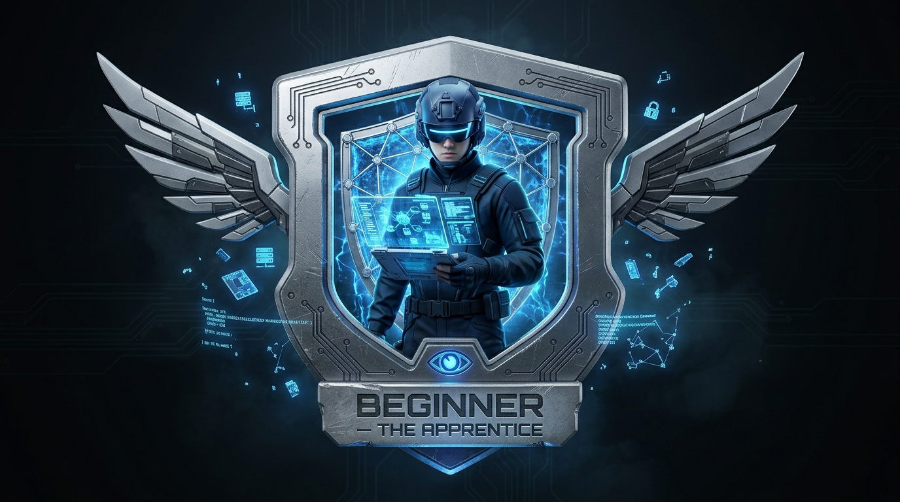

# Case File 2 (Beginner) — Reading Room

Part of **The Halcyon Protocol** CTF series. This box stands alone — you do
not need any other box in the series to play it.

> See [`STORY.md`](STORY.md) for the full case file.

## What this is

A single deliberately-vulnerable web application (PHP + Apache + SQLite)
aimed at players who've done one or two boxes before. 10 flags, no decoys.
The first three are easy; difficulty then climbs through directory
brute-forcing, SQL injection, file upload RCE, steganography, credential
reuse, and a SUID privilege escalation.

**This machine is intentionally vulnerable. Run it only on an isolated
network.**

## Running it

Download the `.ova` from this repo's [Releases](../../releases) page
and import it into VirtualBox (File > Import Appliance) or VMware
Workstation/Fusion (File > Open). It boots and sets itself up
automatically — nothing to configure. See [`vm/README.md`](vm/README.md)
for details and for rebuilding it from source.

There is no Docker build in this repo (an earlier one was removed; a
Docker version may be added back separately).

## Flag format

`HLC{xxxxxxxxxx}` — submit exactly as found.

## Rules

- No decoy flags: everything matching the flag format is real and counts.
- Some things in this box are honeypots — red herrings that cost you time,
  not flags.
- Don't attack this box over a shared or public network.

## More

- [`STORY.md`](STORY.md) — the in-universe case file
- [`docs/hints.md`](docs/hints.md) — progressive hints
- [`docs/tools.md`](docs/tools.md) — what each tool is for
- [`docs/writeup/WRITEUP.md`](docs/writeup/WRITEUP.md) — full spoiler walkthrough
- [`flags/generate_flags.php`](flags/generate_flags.php) — the flag
  derivation scheme (HMAC-SHA256 of a release secret), used by
  `organizer/verify.py`. The OVA's flags are static (same release
  secret baked in at build time).
